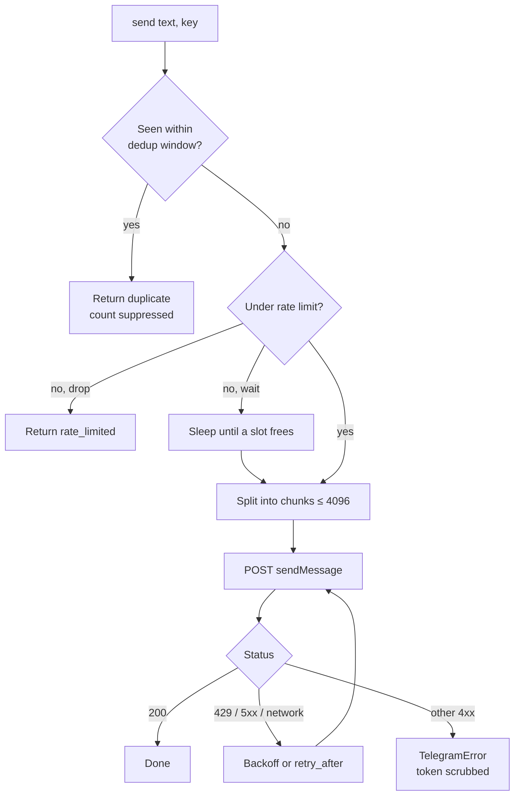

# bot-telegram-alerts


Telegram alerts for bots and long-running scripts that **don't spam you, don't hit API limits and don't leak your bot token**. One small class, standard library only.

```python
from bot_telegram_alerts import TelegramAlerter

alerts = TelegramAlerter(token=os.environ["TG_TOKEN"], chat_id=os.environ["TG_CHAT_ID"])

alerts.send("Worker restarted")
alerts.send("Disk almost full", key="disk")      # repeats within 5 min are suppressed
alerts.send_safe("Feed is down")                  # never raises: alerting must not crash your bot
```

## Why

A naive `requests.post(sendMessage)` works until something breaks. Then a failing loop sends 500 identical messages, Telegram answers `429 Too Many Requests`, your exception log prints the URL containing the token, and the alert that mattered is buried.

| Problem | What it does |
|---|---|
| Same alert every second | **Dedup** by key/text within a window; the next message says `(+N repeated)` |
| Telegram flood limits | **Rate limit** per rolling minute: drop excess or wait |
| `429`, `5xx`, network blips | **Retries** with backoff; honours Telegram's `retry_after` |
| Messages over 4096 chars | **Split** on line boundaries, in order |
| `<`, `&`, `_`, `.` breaking `parse_mode` | `escape_html()` and `escape_markdown_v2()` helpers |
| Token in logs/tracebacks | Token is scrubbed from errors and excluded from `repr` |
| Alert failure crashing the bot | `send_safe()` returns a result instead of raising |
| Hard to test | Inject `transport`, `clock` and `sleep`; no network needed |

## How a message flows



## Install

```bash
pip install git+https://github.com/sergiogoqui-cpu/bot-telegram-alerts.git
```

## Setup

1. Talk to **@BotFather** on Telegram, send `/newbot`, copy the token.
2. Send any message to your new bot, then open `https://api.telegram.org/bot<TOKEN>/getUpdates` to find your `chat_id`.
3. Keep both in environment variables, never in code.

## Usage

### Formatting

```python
from bot_telegram_alerts import escape_html

alerts.send(f"<b>Error</b>: {escape_html(str(exc))}", parse_mode="HTML")
```

### Tune the behaviour

```python
alerts = TelegramAlerter(
    token, chat_id,
    dedup_window=600,      # seconds
    max_per_minute=10,
    on_limit="wait",       # "drop" (default) or "wait"
    max_retries=5,
)
```

### Silent notifications

```python
alerts.send("Daily report ready", silent=True)
```

### Know what happened

```python
result = alerts.send("x")
result.sent, result.reason, result.chunks   # True, "ok", 1
alerts.stats                                  # sent, duplicates, rate_limited, failed, retries
```

### Test your own code

```python
def fake(url, payload):
    sent.append(payload["text"])
    return 200, {"ok": True}

alerts = TelegramAlerter("t", 1, transport=fake)
```

## API

| Name | Purpose |
|---|---|
| `TelegramAlerter(token, chat_id, dedup_window, max_per_minute, max_retries, on_limit, timeout, transport, clock, sleep)` | The client |
| `.send(text, key, parse_mode, silent)` | Returns `SendResult`; raises `TelegramError` on permanent failure |
| `.send_safe(...)` | Same, but never raises |
| `split_message(text, limit)` | Split text for Telegram's limit |
| `escape_html`, `escape_markdown_v2` | Escape helpers |

## Notes

- Dedup and rate-limit state live in memory, per `TelegramAlerter` instance.
- The class is synchronous. In asyncio code run it in a thread: `await asyncio.to_thread(alerts.send, text)`.

## Development

```bash
pip install -e . pytest
pytest
```

## License

MIT. Issues and pull requests are welcome.
